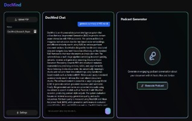
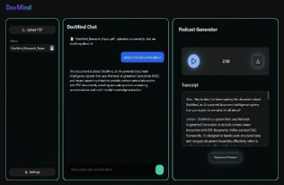
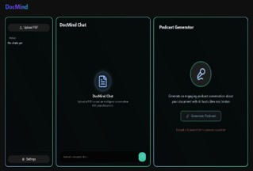

## Environment Variables

Create a `.env` file in the project root and add the following variables:

```env
GROQ_API_KEY=your_groq_api_key
ELEVENLABS_API_KEY=your_elevenlabs_api_key
GOOGLE_CLIENT_ID=your_google_client_id
GOOGLE_CLIENT_SECRET=your_google_client_secret
JWT_SECRET_KEY=your_jwt_secret_key
```

You can also copy the `.env.example` file:

```bash
cp .env.example .env
```


<p align="center">
  
  
</p>

<p align="center">
  
</p>
